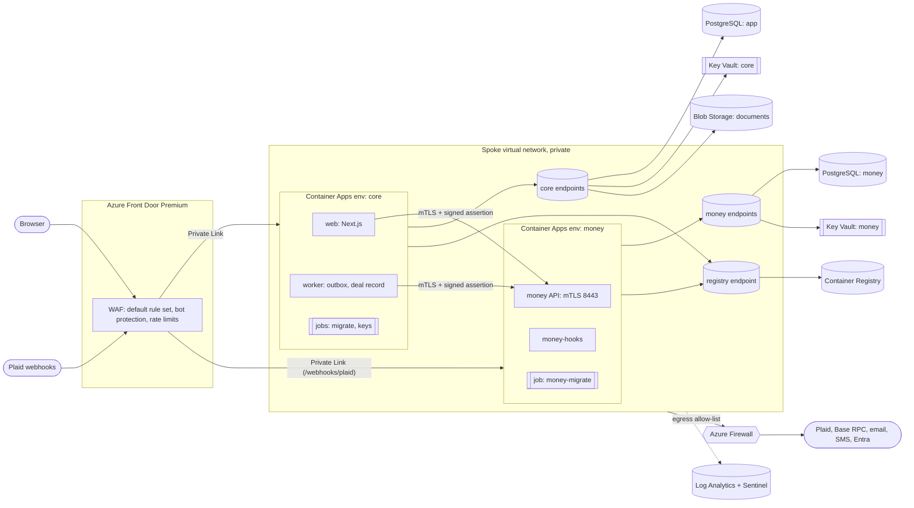

# The rails: Sagolik Close on Microsoft Azure

The target platform for running Sagolik Close in a bank-grade environment. [../platform-review.md](../platform-review.md) explains where we start from. The infrastructure is code in [`infra/azure`](../../infra/azure), deployed by [`.github/workflows/deploy-azure.yml`](../../.github/workflows/deploy-azure.yml); the steps are in [runbook.md](runbook.md).

## Principles

1. **Nothing but the edge is public.** Browsers and provider webhooks reach Azure Front Door, with a web application firewall. Every app, database, key vault and storage account has public access disabled and is reached over private endpoints. The registry denies public traffic too, except from the deploy pipeline's own runner for the length of a push.
2. **No secrets in configuration.** Workloads authenticate with managed identities: to PostgreSQL (Entra tokens; no database passwords exist), Key Vault, Blob Storage and the registry. The deploy pipeline signs in with OpenID Connect, so no cloud credentials are stored in GitHub. The few remaining secrets (session secret, certificates, provider secrets) live in Key Vault and are referenced by the apps, never copied.
3. **Keys stay in hardware.** Key-encryption keys and the deal-record signing key are generated inside HSM-backed Key Vault keys and never leave them. Apps ask Key Vault to wrap, unwrap or sign. Data keys are wrapped inside the network, by a job, so they never exist on anyone's laptop.
4. **The money boundary is a network boundary too.** The Go money service runs in its own Container Apps environment and subnet, with its own database server and key vault. It accepts calls only from the core subnet, over mutual TLS with signed user assertions. Plaid webhooks reach it only through the WAF.
5. **Everything is evidence.** Every resource sends diagnostics to one Log Analytics workspace, with the Activity Log. Microsoft Sentinel runs on it, over platform logs and our own audit events.
6. **Least privilege, by identity.** Each workload has its own identity, with only the roles it needs on the specific key, container or registry. Database roles follow the same rule: migrations run as the server's Entra administrator; the apps' login roles can only act as the API roles. People get elevated rights through Privileged Identity Management.

## Topology

## Layer by layer

### Edge

**Azure Front Door Premium** is the only public endpoint. Premium is the tier that reaches private origins, so development uses it too.
- **WAF:** Microsoft's default rule set 2.1, the bot manager rule set, a rate limit on sign-in attempts per client and one on `/api/`. Prevention mode in production; detection mode in development, to learn false positives on real traffic first.
- **Origins:** the internal Container Apps environments, over Private Link. Each Private Link request is approved on its environment by the pipeline, which approves only requests carrying a message derived from the Front Door profile's own id. Neither environment accepts public traffic.
- **TLS:** a managed certificate for `close.sagolik.com`, TLS 1.2 or later; HTTP redirects to HTTPS.
- **Headers and caching:** the app sets CSP with nonces, HSTS and the other security headers. Nothing is cached.

### Compute: Azure Container Apps

Two environments on workload profiles, each in its own subnet, internal only, with public network access disabled, encrypted traffic between replicas, and zone redundancy in production:

| Environment | Apps and jobs | Notes |
| --- | --- | --- |
| `core` | `web` (Next.js), `worker`; jobs `migrate` and `keys` | The web app scales on HTTP load (at least two replicas in production). Exactly one worker, so deal-record entries go out one at a time and their nonces never race. `migrate` runs migrations as the database's Entra administrator and grants the apps' database roles. `keys` runs the key ceremony. Demo environments have no worker: events are processed in the web app, where the sandbox providers live. |
| `money` | `money` (Go API), `money-hooks` (Plaid webhooks); job `money-migrate` | The same image three ways. The API's ingress is TCP passthrough: the service terminates TLS itself and checks the caller's client certificate, so the platform never sees the traffic in clear. |

Why Container Apps rather than AKS:
- Container Apps gives VNet isolation, managed identities, Key Vault references and zone redundancy, without running Kubernetes.
- AKS remains an option if we later need cluster-level controls, such as network policies between pods or a service mesh. The images and identities carry over unchanged.

### Data

| Store | Service | Settings |
| --- | --- | --- |
| App database | Azure Database for PostgreSQL Flexible Server 16 | Entra authentication only (password authentication off), TLS 1.2+ required, private endpoint, point-in-time restore (35 days in production), geo-redundant backups and zone-redundant high availability in production, pgaudit for schema and role changes, connection logging. Deletion lock in production |
| Money database | A separate Flexible Server | Same settings. Reachable only from the money subnet; the web app has no credentials for it |
| Documents | Azure Storage (Blob), GZRS in production | No account keys (Entra only), no public access, a customer-managed key from Key Vault on top of infrastructure encryption, versioning, soft delete and change feed (35 days), and Defender's malware scanning on every upload. Object keys are written once by the app |

Row-level security carries over unchanged:
- **On Supabase,** the request's JWT claims set `auth.uid()`.
- **On Azure,** the PostgreSQL store sets the same claims inside each transaction and takes the `authenticated` role for a person's reads, or `service_role` for the service layer's writes.

The workloads' login roles hold those memberships without inheriting them, so a query that doesn't take a role can read nothing. The same policies and the same 77 SQL security checks pass on the Azure flavour (CI's `database-azure` job, with migrations run as a non-superuser, as on Azure). People's reads leave out the columns the database hides from them (the encrypted account number).

Planned with legal: a `records` container with a time-based immutability policy for executed documents, once the retention period is set.

### Keys and secrets

Two Key Vaults, Premium tier (HSM-backed keys), RBAC authorization, purge protection, private endpoints only, deletion lock in production:

| Vault | Keys (generated in the HSM) | Secrets | Who can use what |
| --- | --- | --- | --- |
| `kv-core` | `data-kek` (RSA-HSM 3072): wraps the web app's data keys. `chain-recorder` (EC-HSM, secp256k1): signs deal-record entries. `storage-cmk` (RSA-HSM 3072): encrypts Blob Storage | Session secret, wrapped data keys and the version that wrapped them, the deal-record salt and recording key version, the web app's and worker's mTLS client certificates and the assertion signing key | Web: wrap/unwrap with `data-kek`, read the vault's secrets. Worker: the same, plus **sign** with `chain-recorder`. Storage: wrap/unwrap with `storage-cmk` only |
| `kv-money` | `money-kek` (RSA-HSM 3072): wraps every bank token and account number | The money service's server certificate and key, the internal CA, the web app's public keys (JWKS), the Plaid secret | The money service only |

- **Data keys** are generated and wrapped by the `keys` job inside the network. Configuration holds only the wrapped keys and the exact `data-kek` version, so rotating the key can't break start-up. Rotation and re-wrapping are in the runbook.
- **The deal-record recording key** is created inside Key Vault as a secp256k1 key. The worker asks Key Vault to sign each transaction (ES256K over the transaction hash) and normalises the signature for Ethereum. The key never exists outside the HSM, and the recording account is its address. Production refuses a raw key.
- **Secrets** are written by an operator through Azure Resource Manager ([`scripts/set-secrets.sh`](../../infra/azure/scripts/set-secrets.sh)), since the vaults have no public access. They're never stored in GitHub or in deployment history.

Upgrade path: **Managed HSM**. It's single-tenant, at a fixed hourly price. The key types and code are the same.

### Identity

- **People who work in closings** (title, escrow, lenders, agents, Sagolik staff): Microsoft Entra ID, with Conditional Access and phishing-resistant MFA. Organizations can federate their own Entra or other identity provider.
- **Consumers** (buyers, sellers, homeowners): Microsoft Entra External ID on our own domain, with MFA and passkeys.
- **Step-up confirmation** for money actions maps to a fresh authentication with MFA, requested through an authentication context.
- **Sagolik administrators** get elevated Azure and app rights only through Privileged Identity Management.

This is the next change after this one. Until then the Azure environment runs the fictional demo with its demo sign-in, and production's apps don't start: the configuration refuses demo sign-in in production.

### Network

- **One spoke VNet per environment.** Subnets:
  - `core` and `money` (each delegated to Container Apps, /23)
  - private endpoints, one subnet per trust zone: core data, money data, and the registry
  - Azure Firewall (production)
- **Network security groups** allow only the flows the design needs, and deny other traffic between subnets:
  - core subnet to the core endpoints (443, 5432); money subnet to the money endpoints (443, 5432); both to the registry endpoint (443)
  - core subnet to the money API (8443)
  - traffic within each environment's own subnet, which includes Front Door's Private Link connections
- **Egress through Azure Firewall**, with threat intelligence in deny mode and an allow-list:
  - the platform's own dependencies, by service tag: Entra, Azure Monitor, Microsoft Container Registry
  - from the core subnet: Resend, Twilio, the Base RPC endpoint
  - from the money subnet: Plaid

  Development uses a NAT gateway instead (no filtering, much cheaper).
- **Private DNS zones** for every private endpoint, and for the money environment's own domain so the web app can reach the money API by name.

### Observability and security operations

- **Log Analytics** receives diagnostics from every resource (resource-specific tables), the subscription's Activity Log, and container logs. Application logs are JSON lines with `requestId` and `correlationId`. Retention: 90 days in production, 30 in development.
- **Audit events** are written to the database (append-only) and also logged as structured `audit` lines with ids and the action only, never names or contact details, so the SIEM sees them.
- **Microsoft Sentinel** on the workspace. Starting detections ([`infra/azure/sentinel/detections.kql`](../../infra/azure/sentinel/detections.kql)), created as scheduled rules once data has arrived:
  - repeated failed step-up confirmations by one person
  - payment instructions created or a beneficiary changed
  - one person downloading many documents
  - webhooks rejected in bulk
  - privileged access and feature-flag changes
  - WAF blocks spiking from one client
  - Key Vault refusing requests
  - deal-record entries failing
- **Microsoft Defender for Cloud** across the subscription: CSPM, Containers (registry scanning), Key Vault, open-source databases, Storage (malware scanning on upload, sensitive data discovery) and Resource Manager.
- Planned: long-term export of logs to immutable storage, for the period our customers require (typically 7 years).

### Delivery and supply chain

- **GitHub Actions to Azure with OpenID Connect.** The pipeline's identity is federated to this repository's GitHub environments; no secret exists to leak. Production deployments need a reviewer's approval in GitHub.
- **Phases:** `platform`, then `ceremony` (images and the key ceremony), then `apps` (every release). Each deployment shows a `what-if` preview first.
- **Images:** built per release from the commit, pushed to the private registry and deployed by digest. Each image gets a signed build-provenance attestation (keyless, through GitHub's OpenID Connect). Defender for Containers scans the registry. CI builds all three images on every push.
- **Releases** then run the migrate jobs, approve Front Door's Private Link requests, and pass a smoke test through Front Door.
- **Every push and pull request** compiles the Bicep with no warnings, runs the linter with strict rules (`bicepconfig.json`) and Checkov on the compiled templates (skips explained in `.checkov.yaml`), alongside the existing test suites.
- Next: promote the same image digest from development to production instead of rebuilding.

### Resilience

- Zone redundancy in production for Container Apps, PostgreSQL (synchronous standby in another zone), Key Vault, Front Door, the registry and storage (GZRS).
- **Targets:**
  - within a region: RPO under 1 minute, RTO under 15 minutes
  - after losing a region: RPO under 1 hour (geo-redundant backups and storage), RTO under 8 hours (redeploy from code into the paired region)
- **Restore drills** at least twice a year, recorded as evidence (runbook). DORA expects tested continuity plans from ICT providers to financial entities.

### Governance

- In the template: resources allowed only in the environment's region, a monthly budget with alerts to the subscription's owners, and deletion locks on production's data stores and vaults.
- At the management group, owned by whoever runs the Azure estate: Azure Policy for no public network access on storage, Key Vault and databases, required diagnostic settings, Defender plans and required tags.

## Environments and regions

| Environment | Purpose | Notes |
| --- | --- | --- |
| `dev` | The fictional demo on the real platform, with sandbox providers | Burstable database, NAT gateway instead of Azure Firewall, no money service (the demo keeps payment instructions in the app, encrypted with its own wrapped data keys), WAF in detection mode |
| `prod` | Real closings | Everything above. Its apps wait for Entra sign-in and contracted providers |

Region is a parameter. **East US 2** is the default for the first market (US closings, with US data kept in the US). **Sweden Central** for European markets. Each market's data stays in its region.

## Indicative monthly cost (list prices, before reservations)

Verify in the Azure pricing calculator; these are orders of magnitude for planning, not quotes.

| Item | Production | Development |
| --- | --- | --- |
| Front Door Premium + WAF | ~$350 + traffic | ~$350 + traffic |
| Container Apps (consumption, zone-redundant in production) | ~$300–600 | ~$50 |
| PostgreSQL: two servers (D4ds_v5, zone-redundant HA) / one burstable | ~$1,000–1,200 | ~$15 |
| Azure Firewall Standard / NAT gateway | ~$900 + data | ~$35 |
| Key Vault Premium, Storage, Container Registry Premium, private endpoints | ~$200–300 | ~$100 |
| Log Analytics, Sentinel, Defender plans | ~$300–800, depends on volume | ~$50–100 |
| **Total** | **roughly $3,100–4,200** | **roughly $600–700** |

Managed HSM, if chosen instead of Key Vault Premium, adds about $2,300 a month. The parameter files set budgets of $5,000 (production) and $800 (development).

## What's built, and what's next

Done in this change:
- Bicep for a whole environment, in phases, validated in CI.
- The direct PostgreSQL store with RLS claims and Entra token authentication, and migrations without the Supabase CLI.
- The Blob Storage document store.
- Data keys wrapped by Key Vault, with the key ceremony and re-wrap commands.
- HSM signing for the deal record.
- The money service on Key Vault and Entra, with its own migrate command.
- The deploy pipeline with OpenID Connect and signed build provenance.
- Audit lines for the SIEM, and starting Sentinel detections.

Next, in order:
1. First deployment of `dev`.
2. Identity on Entra (sign-in, MFA, step-up through authentication contexts).
3. Restore drill.
4. Penetration test.
5. Production.
